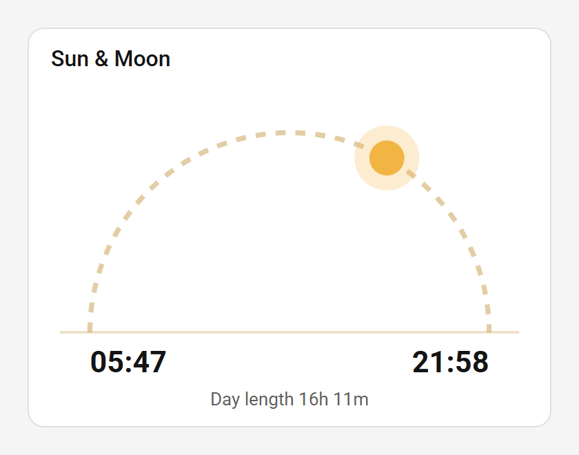
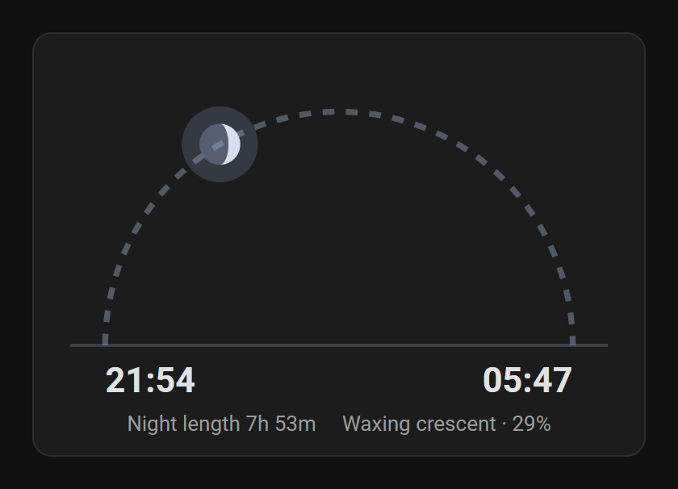
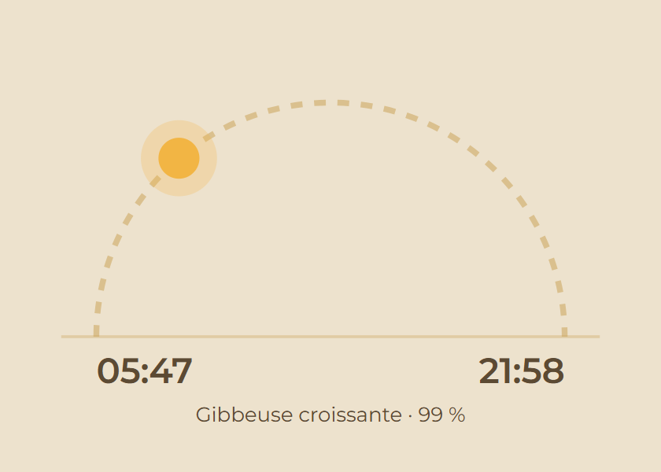
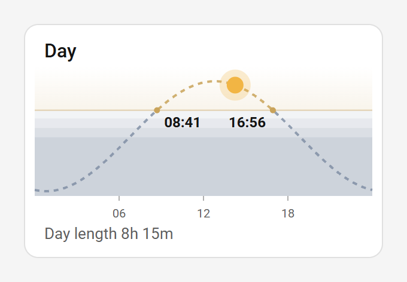
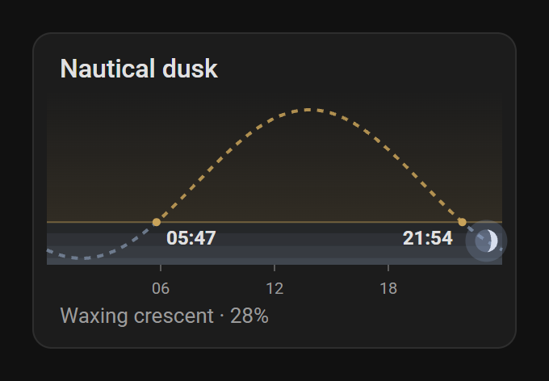
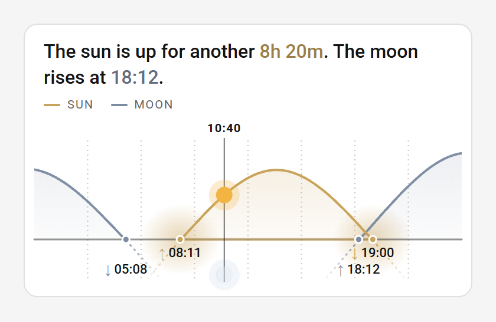
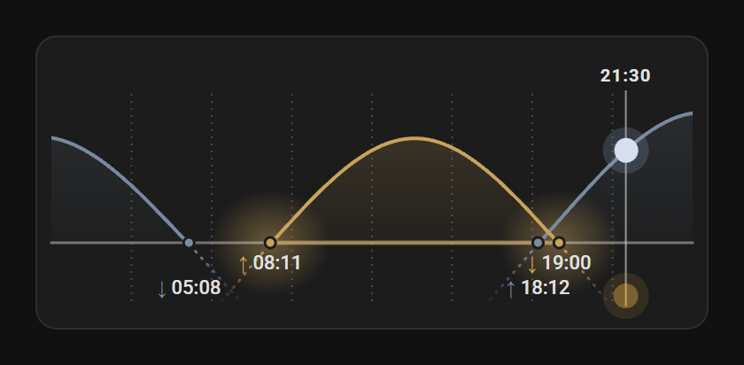

# Celestial Arc Card

[](https://my.home-assistant.io/redirect/marketplace_repository/?owner=HappyManuDev&repository=celestial-arc-card&category=plugin)
[](https://github.com/HappyManuDev/celestial-arc-card/releases/latest)
[](LICENSE)

A [Home Assistant](https://www.home-assistant.io/) Lovelace card that shows the **sun travelling along an arc from sunrise to sunset**, and the **moon, with its real phase, from sunset to sunrise**.

|                                                                                Day, light theme                                                                                |                                                                                   Night, dark theme                                                                                    |                                                                         Transparent, custom palette                                                                         |
| :----------------------------------------------------------------------------------------------------------------------------------------------------------------------------: | :------------------------------------------------------------------------------------------------------------------------------------------------------------------------------------: | :-------------------------------------------------------------------------------------------------------------------------------------------------------------------------: |
|  |  |  |
|                                                      `background: true`<br>`title: Sun & Moon`<br>`show_day_length: true`                                                      |                                                        `background: true`<br>`show_day_length: true`<br>`show_moon_phase: true`                                                        |                                            [Vintage example](#vintage--warm-palette)<br>`show_moon_phase: true`<br>French locale                                            |

**New:** a second layout, `wave`, shows the **sun's course over 24 hours**, crossing the horizon at sunrise and sunset, above the **twilight bands**:

|                                                                                                       Wave, winter day, light theme                                                                                                        |                                                                                          Wave, summer night, dark theme                                                                                          |
| :----------------------------------------------------------------------------------------------------------------------------------------------------------------------------------------------------------------------------------------: | :--------------------------------------------------------------------------------------------------------------------------------------------------------------------------------------------------------------: |
|  |  |
|                                                                                      `layout: wave`<br>`background: true`<br>`show_day_length: true`                                                                                       |                                                                         `layout: wave`<br>`background: true`<br>`show_moon_phase: true`                                                                          |

A third layout, `sky`, draws the **real altitude of the sun and the moon** over 24 hours, with their rise and set times:

|                                                                                                             Sky, autumn morning, light theme                                                                                                             |                                                                                  Sky, autumn evening, dark theme                                                                                   |
| :------------------------------------------------------------------------------------------------------------------------------------------------------------------------------------------------------------------------------------------------------: | :------------------------------------------------------------------------------------------------------------------------------------------------------------------------------------------------: |
|  |  |
|                                                                                               `layout: sky`<br>`background: true`<br>`show_summary: true`                                                                                                |                                                                                `layout: sky`<br>`background: true`                                                                                 |

Feedback and ideas are welcome in the [issues](https://github.com/HappyManuDev/celestial-arc-card/issues).

---

## Table of contents

- [Features](#features)
- [Requirements](#requirements)
- [Installation](#installation)
  - [Marketplace (recommended)](#marketplace-recommended)
  - [HACS (Home Assistant before 2026.11)](#hacs-home-assistant-before-202611)
  - [Manual](#manual)
- [Configuration](#configuration)
  - [Minimal configuration](#minimal-configuration)
  - [Full example](#full-example)
  - [Options](#options)
  - [Colors](#colors)
  - [Actions](#actions)
- [Styling](#styling)
  - [CSS variables](#css-variables)
  - [Using a theme](#using-a-theme)
  - [Using card-mod](#using-card-mod)
- [Examples](#examples)
- [How it works](#how-it-works)
- [Localization](#localization)
- [Accessibility](#accessibility)
- [Privacy](#privacy)
- [Troubleshooting / FAQ](#troubleshooting--faq)
- [Roadmap](#roadmap)
- [Development](#development)
- [Contributing](#contributing)
- [Credits](#credits)
- [License](#license)

---

## Features

- ☀️ **Sun arc**: during the day, the sun moves along a half circle from the **last sunrise** to the **next sunset**.
- 🌙 **Moon arc**: at night, the moon moves from the **last sunset** to the **next sunrise**, drawn with its **real phase** (crescent, quarter, gibbous, full…). It is mirrored in the southern hemisphere.
- 🌊 **Wave layout**: the sun's course over 24 hours, crossing a horizon line at sunrise and sunset, with the civil, nautical and astronomical **twilights** drawn below and the current phase of the sky (day, dawn, dusk, night). See [The wave layout](#the-wave-layout).
- 🌌 **Sky layout**: the real altitude of the sun and the moon over 24 hours, with their rise and set times and the current time. See [The sky layout](#the-sky-layout).
- 🎯 **Accurate times**: the start of the current period is computed astronomically from your Home Assistant location, rather than estimated.
- 🔄 **Always moving**: the card refreshes itself every minute (configurable), so the marker keeps moving even when `sun.sun` does not update. That happens a lot at night.
- ⚡ **Lightweight**: about 23 kB gzipped, and it only re-renders when something relevant changes (the sun entity, your language or locale settings, the clock).
- 🕐 **Respects your profile**: times follow your Home Assistant user profile (12 h or 24 h, server or browser time zone, language).
- 📏 **Optional information**: day or night length, and the moon phase with its illuminated percentage.
- 🎨 **Fully themable**: transparent by default, it follows the light and dark themes, and every color can be changed through options, CSS variables, themes or card-mod.
- 👆 **Actions**: tap and hold actions (`more-info`, `navigate`, `perform-action`…), like the built-in cards.
- 🌍 **Localized**: English and French. Other languages are welcome, see [Localization](#localization).
- ♿ **Accessible**: screen readers get a full description, and the card can be used with the keyboard.
- 🖱️ **Visual editor**: every option can be set without writing YAML.
- 📐 **Works in every view**: masonry, sections (grid) and panel views.

---

## Requirements

- Home Assistant **2024.8** or newer.
- The [Sun integration](https://www.home-assistant.io/integrations/sun/) enabled. It is enabled by default and provides the `sun.sun` entity.
- Your home location set in **Settings → System → General**. Without it, the card falls back to an approximation, see [How it works](#how-it-works).

---

## Installation

### Marketplace (recommended)

Since Home Assistant **2026.11**, community cards are installed from the built-in **Marketplace** (**Settings → Marketplace**), which replaces HACS.

The card is not in the Marketplace catalog yet, so it is added as a **custom repository**:

1. Click this button. It opens the card's page in the Marketplace of your Home Assistant instance:

   [](https://my.home-assistant.io/redirect/marketplace_repository/?owner=HappyManuDev&repository=celestial-arc-card&category=plugin)

2. Accept to add it as a custom repository (type **Dashboard**).
3. Click **Download**.
4. **Reload your browser** (clear the cache if needed, or restart the companion app).

The Marketplace registers the dashboard resource automatically. If your dashboard resources are managed in YAML, add the resource yourself, as shown in the install dialog. Once the card is in the catalog, search for **Celestial Arc Card** under **Settings → Marketplace** and skip step 2.

### HACS (Home Assistant before 2026.11)

1. Open **HACS** in Home Assistant.
2. Click the **⋮** menu (top right) → **Custom repositories**.
3. Repository: `https://github.com/HappyManuDev/celestial-arc-card`. Type: **Dashboard**. Click **Add**.
4. Search for **Celestial Arc Card** in HACS, open it and click **Download**.
5. **Reload your browser**.

HACS registers the dashboard resource automatically.

### Manual

1. Download `celestial-arc-card.js` from the [latest release](https://github.com/HappyManuDev/celestial-arc-card/releases/latest).
2. Copy it to `<config>/www/celestial-arc-card.js` on your Home Assistant server.
3. Add the resource:
   - **UI**: **Settings → Dashboards → ⋮ → Resources → Add resource**. URL: `/local/celestial-arc-card.js`. Type: **JavaScript module**.
   - **YAML mode**:
     ```yaml
     lovelace:
       resources:
         - url: /local/celestial-arc-card.js
           type: module
     ```
4. Reload your browser.

> [!TIP]
> After a manual update, add a version suffix to the resource URL (for example `/local/celestial-arc-card.js?v=1.0.0`), so that browsers do not keep the old file in cache.

To check that the card is loaded, open your browser's developer console: a `CELESTIAL ARC CARD vX.Y.Z` banner is printed.

---

## Configuration

### Visual editor

Edit a dashboard, click **Add card** and search for **Celestial Arc Card**. Every option can be set from the form:

- sun entity, title, layout (arc, wave or sky), what to show at night, information to display, card background, refresh interval;
- **Colors** section: any CSS color, leave a field empty to keep the default;
- **Interactions** section: tap and hold actions.

The editor only saves the options you changed, so the YAML stays short. It is translated into English and French. Everything below can also be written in YAML: click **Show code editor** in the card editor.

### Minimal configuration

```yaml
type: custom:celestial-arc-card
```

`entity` defaults to `sun.sun`, so this is all you need.

### Full example

```yaml
type: custom:celestial-arc-card
entity: sun.sun
title: Sky
layout: arc
night_mode: moon
show_times: true
show_day_length: true
show_moon_phase: true
background: true
update_interval: 60
colors:
  day_arc: '#c9a35a'
  night_arc: '#7c8ba1'
  sun: '#f2b544'
  moon: '#d7deed'
  label: var(--primary-text-color)
tap_action:
  action: more-info
hold_action:
  action: navigate
  navigation_path: /lovelace/weather
```

### Options

| Option            | Type                     | Required | Default             | Description                                                                                                                                                                                           |
| ----------------- | ------------------------ | -------- | ------------------- | ----------------------------------------------------------------------------------------------------------------------------------------------------------------------------------------------------- |
| `type`            | string                   | **yes**  | -                   | `custom:celestial-arc-card`                                                                                                                                                                           |
| `entity`          | string                   | no       | `sun.sun`           | Sun entity providing `next_rising` and `next_setting`.                                                                                                                                                |
| `title`           | string                   | no       | -                   | Title shown above the arc.                                                                                                                                                                            |
| `layout`          | `arc` \| `wave` \| `sky` | no       | `arc`               | `arc`: half circle for the current day or night. `wave`: 24-hour curve, see [The wave layout](#the-wave-layout). `sky`: real altitude of the sun and the moon, see [The sky layout](#the-sky-layout). |
| `night_mode`      | `moon` \| `none`         | no       | `moon`              | What to show at night: the moon with its real phase, or nothing (arc only).                                                                                                                           |
| `show_times`      | boolean                  | no       | `true`              | Show the start and end times of the current period under the arc.                                                                                                                                     |
| `show_day_length` | boolean                  | no       | `false`             | Show the length of the current period: “Day length 16h 11m” by day, “Night length 7h 49m” by night.                                                                                                   |
| `show_moon_phase` | boolean                  | no       | `false`             | Show the moon phase and its illuminated percentage, e.g. “Waxing gibbous · 78%”. Shown day and night.                                                                                                 |
| `show_summary`    | boolean                  | no       | `false`             | Sky layout only: a sentence above the chart, e.g. “The sun is up for another 5h 28m. The moon rises at 22:14.”, with a legend.                                                                        |
| `background`      | boolean                  | no       | `false`             | `false`: transparent card, no border or shadow. `true`: standard Home Assistant card background.                                                                                                      |
| `update_interval` | number                   | no       | `60`                | Refresh interval in seconds, between `10` and `3600`.                                                                                                                                                 |
| `colors`          | map                      | no       | theme               | Custom colors, see [Colors](#colors).                                                                                                                                                                 |
| `tap_action`      | [action](#actions)       | no       | `action: more-info` | Action on tap or click.                                                                                                                                                                               |
| `hold_action`     | [action](#actions)       | no       | `action: none`      | Action on long press (500 ms).                                                                                                                                                                        |

An invalid option (unknown `night_mode`, `update_interval` outside 10–3600, unknown color key…) shows a clear error message in the dashboard instead of the card.

### Colors

All keys are optional. Any CSS color works: `'#f2b544'`, `rgb(…)`, `orange`, or a theme variable such as `var(--accent-color)`.

| Key         | Default                                                                           | Applies to                                                       |
| ----------- | --------------------------------------------------------------------------------- | ---------------------------------------------------------------- |
| `day_arc`   | `#c9a35a`                                                                         | Arc and horizon line during the day, sun curve of the sky layout |
| `night_arc` | `#7c8ba1`                                                                         | Arc and horizon line at night, moon curve of the sky layout      |
| `sun`       | `#f2b544`                                                                         | Sun and its halo                                                 |
| `moon`      | `#d7deed`                                                                         | Lit part of the moon                                             |
| `label`     | `var(--primary-text-color)` (times) / `var(--secondary-text-color)` (information) | Times under the arc and the information line                     |

> Remember to quote hexadecimal colors in YAML (`'#f2b544'`). Otherwise `#` starts a comment.

### Actions

`tap_action` and `hold_action` accept the [standard Home Assistant actions](https://www.home-assistant.io/dashboards/actions/):

| `action`         | Effect                                                      |
| ---------------- | ----------------------------------------------------------- |
| `more-info`      | Opens the more-info dialog of `entity` (default tap action) |
| `navigate`       | Goes to `navigation_path`                                   |
| `url`            | Opens `url_path`                                            |
| `perform-action` | Calls `perform_action` with optional `data` / `target`      |
| `assist`         | Opens Assist                                                |
| `none`           | Does nothing (default hold action)                          |

When both actions are `none`, the card is not clickable: no pointer cursor, and it is not focusable with the keyboard.

To make the card purely decorative:

```yaml
type: custom:celestial-arc-card
tap_action:
  action: none
```

With the keyboard, **Enter** or **Space** triggers the tap action.

---

## Styling

### CSS variables

Besides the `colors` option, the card reads the following CSS variables. You can set them from a theme or with card-mod.

| Variable                | Default                                           | Description                         |
| ----------------------- | ------------------------------------------------- | ----------------------------------- |
| `--cac-day-arc-color`   | `#c9a35a`                                         | Day arc and horizon                 |
| `--cac-night-arc-color` | `#7c8ba1`                                         | Night arc and horizon               |
| `--cac-sun-color`       | `#f2b544`                                         | Sun and halo                        |
| `--cac-moon-color`      | `#d7deed`                                         | Lit part of the moon                |
| `--cac-moon-halo-color` | `#8fa3c9`                                         | Moon halo and dark part of the moon |
| `--cac-label-color`     | `--primary-text-color` / `--secondary-text-color` | Times and information line          |
| `--cac-font-family`     | inherited from the theme                          | Font of the whole card              |

The `colors` option has priority over these variables. Background, border and shadow follow the standard `--ha-card-*` variables when `background: true`.

### Using a theme

```yaml
# themes/my_theme.yaml
my_theme:
  cac-sun-color: '#ffcc33'
  cac-night-arc-color: '#5b6b8c'
  cac-font-family: Montserrat, sans-serif
```

Home Assistant themes declare variables without the leading `--`.

### Using card-mod

With [card-mod](https://github.com/thomasloven/lovelace-card-mod):

```yaml
type: custom:celestial-arc-card
card_mod:
  style: |
    ha-card {
      --cac-font-family: Montserrat, sans-serif;
      --cac-label-color: #5c4a33;
    }
```

> If you use a web font such as Montserrat, it must be loaded by your theme or dashboard. The card does not load fonts itself.

---

## Examples

### Decorative, no interaction

```yaml
type: custom:celestial-arc-card
tap_action:
  action: none
```

### Standard card with all the information

```yaml
type: custom:celestial-arc-card
title: Sun & Moon
background: true
show_day_length: true
show_moon_phase: true
```

### Day only (nothing drawn at night)

```yaml
type: custom:celestial-arc-card
night_mode: none
```

### Vintage / warm palette

A warm style that suits beige or paper-like dashboards:

```yaml
type: custom:celestial-arc-card
tap_action:
  action: none
colors:
  day_arc: '#c9a35a'
  night_arc: '#7c8ba1'
  sun: '#f2b544'
  moon: '#d7deed'
  label: '#5c4a33'
card_mod:
  style: |
    ha-card {
      --cac-font-family: Montserrat, sans-serif;
    }
```

### Night-friendly palette for dark wall tablets

```yaml
type: custom:celestial-arc-card
background: true
colors:
  day_arc: '#e0b866'
  night_arc: '#4a5a7a'
  moon: '#f4f1e8'
  label: '#cfd8e3'
```

---

## How it works

### The arc

With the default `layout: arc`, the card shows a half circle above a horizon line:

- **By day** (`sun.sun` is `above_horizon`), the period runs from the **last sunrise** to the **next sunset**, and the sun is drawn on the arc.
- **By night** (`below_horizon`), the period runs from the **last sunset** to the **next sunrise**, and the moon is drawn on the arc (or nothing, with `night_mode: none`).

The position on the arc is the **elapsed fraction of the current period**: 0% on the left, 50% at the top, 100% on the right. This is a progress indicator, not the actual height of the sun in the sky.

### The wave layout

With `layout: wave`, the card shows a whole day, from midnight (left) to midnight (right), with the same colors as the arc:

- The **curve** is the course of the sun: a cosine peaking at **solar noon**, halfway between sunrise and sunset. It is dashed in the day arc color above the horizon, in the night arc color below.
- The **horizon line** is placed so that the curve crosses it exactly at **sunrise and sunset**, whose times are written next to the crossings. The hump is wide in summer and narrow in winter.
- Below the horizon, **bands** get darker for the civil, nautical and astronomical twilights (sun at −6°, −12° and −18°), then the night. A band ends where the curve reaches it. Near the summer solstice at mid latitudes, the sun never goes below −18°: there is no night band.
- The **marker** is at the current time of day: the sun above the horizon, the moon with its phase below it (nothing with `night_mode: none`).
- The **phase of the sky** is written above: _Day_, _Civil dawn_, _Nautical dusk_, _Night_…
- An **hour axis** (6, 12, 18 h) follows your time format.

The curve shows the shape of the day, not the exact elevation of the sun in degrees. Twilight times are computed with SunCalc from your home location: without it, everything below the horizon is shown as night. All the options apply (`background`, `colors`, `show_times`, information line). In sections views the card takes half the width by default.

```yaml
type: custom:celestial-arc-card
layout: wave
background: true
show_day_length: true
```

### The sky layout

With `layout: sky`, the card shows the day from midnight (left) to midnight (right), like the wave, but with the **real altitude** of the sun and the moon in degrees, computed with SunCalc from your home location:

- The **sun curve** (day arc color) and the **moon curve** (night arc color) are drawn above the horizon with a light fill. Below the horizon, only a short dotted start of each curve is shown, fading out.
- The vertical scale goes from the horizon to just above the highest point of the day: the curves are higher in summer than in winter.
- The brighter the moon, the stronger its curve: faint around the new moon, full strength at the full moon.
- A soft **glow** marks sunrise and sunset on the horizon, and the horizon is tinted between them.
- With `show_times`, the rise (↑) and set (↓) times are written under the horizon: the sun on the first row, the moon on the second.
- A **vertical line** marks the current time, with both markers on it: the sun, and the moon with its phase. The one below the horizon is faded.
- With `show_summary: true`, a sentence above the chart says how long the sun stays up (or when it rises) and when the moon next rises or sets.
- `night_mode: none` hides the moon. `show_day_length` and `show_moon_phase` add the usual information line.

This layout needs your home location. Without it, the card asks you to set it.

```yaml
type: custom:celestial-arc-card
layout: sky
background: true
```

### Where the times come from

- The **end** of the period comes from `sun.sun` (`next_setting` by day, `next_rising` by night). This is the same value Home Assistant uses everywhere else.
- The **start** of the period (last sunrise or last sunset) is not exposed by `sun.sun`, so the card computes it astronomically with [SunCalc](https://github.com/mourner/suncalc), from the latitude and longitude of your Home Assistant installation.
- If no location is configured, the card falls back to _“next opposite event minus 24 hours”_. That approximation is off by a few minutes, because days lengthen or shorten.

### The moon

The moon phase (illuminated fraction, waxing or waning) is computed with SunCalc. The lit part is drawn as an exact SVG shape, a half disk plus an ellipse for the terminator, rather than a mask. It works on any background:

- **Northern hemisphere**: a waxing moon is lit on the right.
- **Southern hemisphere** (negative latitude): the image is mirrored.

The phase names follow the usual eight phases. _New moon_, _first quarter_, _full moon_ and _last quarter_ are shown for about one day around the exact instant.

### Refreshing

- The card re-renders every `update_interval` seconds (60 by default) to move the marker. `sun.sun` itself only updates every few minutes, and much less often at night.
- Home Assistant pushes a new `hass` object on **every state change in your home**. The card ignores those updates unless the sun entity, your language or locale settings, or the configuration changed.

### Edge cases

| Situation                                                    | Behavior                                                                 |
| ------------------------------------------------------------ | ------------------------------------------------------------------------ |
| Polar day or polar night (no `next_setting` / `next_rising`) | Arc shown without marker or times                                        |
| Sun entity not found                                         | Error message: “Entity not found: …”                                     |
| No home location                                             | Approximate start time (see above). The sky layout asks for the location |
| Server and browser in different time zones                   | Follows your profile setting (server or local)                           |

---

## Localization

The card uses the language of your Home Assistant user profile. Regional variants are supported: `fr-CA` uses `fr`. Unsupported languages fall back to English.

| Language | Code |
| -------- | ---- |
| English  | `en` |
| Français | `fr` |

Translated texts: moon phase names, day, dawn, dusk and night names of the wave layout, sentences and legend of the sky layout, day and night length, error messages, and the screen reader description. Times and percentages are formatted with your locale (`78 %` in French, `78%` in English).

**Adding a language:**

1. Copy `src/localize/languages/en.json` to `src/localize/languages/<code>.json` and translate the values. Keep the `{placeholders}` as they are.
2. Register it in `src/localize/localize.ts`.
3. Open a pull request.

---

## Accessibility

- The card has a full `aria-label`, for example _“Sun rose at 05:47 and sets at 21:58, 51% of the day elapsed”_. The decorative SVG is hidden from screen readers.
- When an action is configured, the card has the `button` role, can be focused with the keyboard (visible focus ring), and **Enter** or **Space** triggers the tap action. Otherwise it has the `img` role and is not focusable.

---

## Privacy

- Everything is computed **in your browser**, from data Home Assistant already sends to the frontend (`sun.sun` and your home coordinates).
- The card makes **no network request**, loads no external resource and collects nothing.

---

## Troubleshooting / FAQ

**The card shows “Custom element doesn't exist: celestial-arc-card”.**
The resource is not loaded. Check that it is listed in **Settings → Dashboards → Resources**, then reload the browser with the cache cleared. In the companion app, clear the frontend cache in the app settings.

**The marker does not move.**
It moves every `update_interval` seconds (60 by default), and the arc covers the whole day, so one minute is a very small step. If it never moves, check that `sun.sun` is not `unavailable`.

**The start time looks wrong by a few minutes.**
Check that your home location is set in **Settings → System → General**. Without it, the card uses an approximation.

**The times are not in my time zone.**
The card follows the _Time zone_ setting of your user profile (server or browser).

**The moon is lit on the wrong side.**
The card mirrors the moon when your home latitude is negative (southern hemisphere). Check your home location.

**There is no moon at night.**
Check that `night_mode` is not set to `none`.

**How do I get my old look back (font, colors)?**
See the [vintage example](#vintage--warm-palette).

**Does it work with other “sun” entities?**
Any entity with `next_rising` and `next_setting` attributes and an `above_horizon` / `below_horizon` state works.

---

## Roadmap

- [x] **Visual editor**: configure the card without YAML.
- [ ] Publication in the **Marketplace catalog** (the former default HACS store).
- [x] Real elevation curve of the sun, and the moon between its own moonrise and moonset, day and night: shown by the `sky` layout.
- [x] Twilight zones (dawn and dusk): shown by the `wave` layout.
- [ ] More languages (contributions welcome).

Ideas and feedback: [open an issue](https://github.com/HappyManuDev/celestial-arc-card/issues).

---

## Development

Requirements: [Node.js](https://nodejs.org/) 20 or newer (24 LTS recommended, see `.nvmrc`).

```bash
git clone https://github.com/HappyManuDev/celestial-arc-card.git
cd celestial-arc-card
npm install
```

| Command              | Description                                                                 |
| -------------------- | --------------------------------------------------------------------------- |
| `npm run build`      | Type check, then build `dist/celestial-arc-card.js` (single file, minified) |
| `npm run typecheck`  | TypeScript check only                                                       |
| `npm test`           | Run the unit tests (Vitest, jsdom)                                          |
| `npm run test:watch` | Run tests in watch mode                                                     |
| `npm run lint`       | ESLint (TypeScript, Lit, Web Components rules)                              |
| `npm run lint:fix`   | ESLint with automatic fixes                                                 |
| `npm run format`     | Format with Prettier                                                        |

The build fails if the bundle exceeds **70 kB**, to keep the card light.

**Screenshots:** `npm run build && npm run screenshots` renders the built card with fictional data and regenerates the images in `docs/images/`. It uses your installed Chrome (`BROWSER_CHANNEL=msedge` to use Edge instead).

**Testing in Home Assistant:** copy `dist/celestial-arc-card.js` to `<config>/www/`, add `/local/celestial-arc-card.js?v=dev` as a JavaScript module resource, and reload the browser after each build. Use a separate test dashboard.

### Project structure

```
src/
├── celestial-arc-card.ts   # Card element: lifecycle, refresh timer, rendering, registration
├── config.ts               # Option validation and defaults
├── editor.ts               # Visual editor (ha-form schema)
├── const.ts                # Card name, version, defaults
├── types.ts                # Configuration types
├── ha-types.ts             # Minimal Home Assistant frontend types
├── styles.ts               # Card CSS and --cac-* variables
├── astro/
│   ├── progress.ts         # Elapsed fraction and position on the arc (pure functions)
│   ├── sun.ts              # Current day/night period from sun.sun + SunCalc
│   ├── wave.ts             # Solar noon, day length, twilight levels of the wave layout
│   ├── sky.ts              # Altitude curves, rises and sets of the sky layout
│   └── moon.ts             # Moon phase and SVG path of its lit part
├── render/
│   ├── arc.ts              # Arc, horizon and SVG geometry
│   ├── sun-marker.ts       # Sun marker
│   ├── moon-marker.ts      # Moon marker
│   ├── labels.ts           # Times under the arc
│   ├── wave.ts             # Wave layout: curve, twilight bands, times, hour axis
│   └── sky.ts              # Sky layout: sun and moon curves, horizon, times
├── localize/
│   ├── localize.ts         # Translation lookup with English fallback
│   └── languages/          # en.json, fr.json
└── utils/
    ├── actions.ts          # Tap / hold / keyboard handling
    ├── format.ts           # Moon phase names, durations, percentages
    └── time-format.ts      # Times following the user's Home Assistant profile
test/                       # Vitest unit tests
```

**Tech stack:** TypeScript (strict), [Lit 3](https://lit.dev/), [Vite](https://vite.dev/) (library mode, single ES module), [SunCalc](https://github.com/mourner/suncalc), [Vitest](https://vitest.dev/), ESLint and Prettier.

---

## Contributing

Contributions are welcome: bug reports, translations, features. See [CONTRIBUTING.md](CONTRIBUTING.md) for the details.

1. Fork the repository and create a branch.
2. Make your changes, with tests when relevant.
3. Make sure `npm run lint`, `npm test` and `npm run build` pass.
4. Use [Conventional Commits](https://www.conventionalcommits.org/) messages (`feat: …`, `fix: …`, `docs: …`): releases and the changelog are generated from them.
5. Open a pull request.

When reporting a bug, please include your Home Assistant version, the card version (shown in the browser console), your browser, your card YAML and a screenshot.

---

## Credits

- Sun and moon computations: [SunCalc](https://github.com/mourner/suncalc) by Volodymyr Agafonkin (BSD-2-Clause).
- Built with [Lit](https://lit.dev/) by Google (BSD-3-Clause).
- Project structure inspired by [clock-weather-card](https://github.com/pkissling/clock-weather-card) by Patrick Kissling.

The license notices of the bundled libraries (Lit and SunCalc) are included at the top of `celestial-arc-card.js`.

---

## License

[MIT](LICENSE) © HappyManuDev
